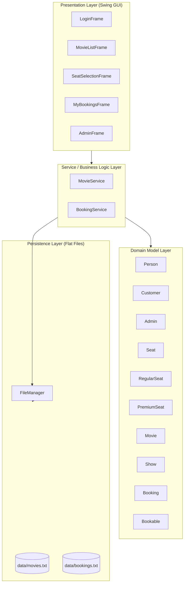
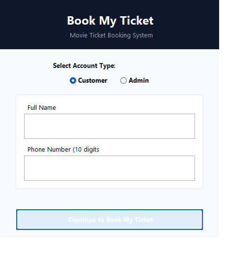
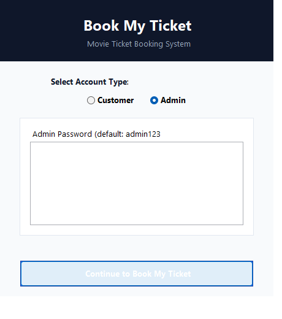
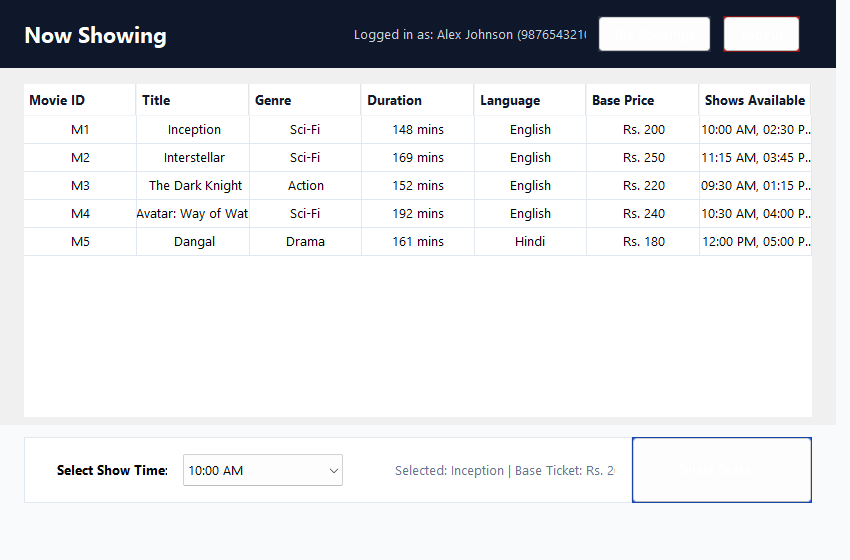
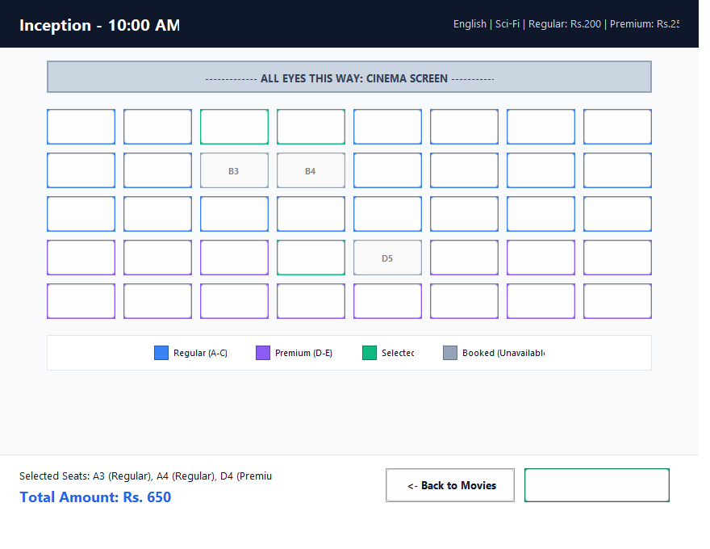
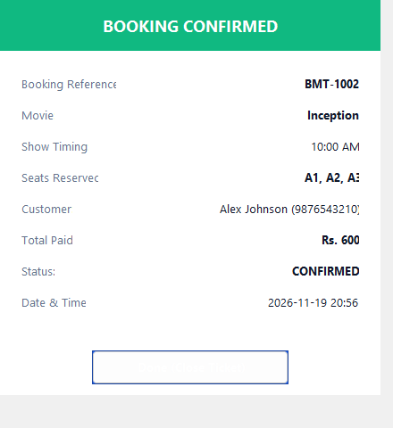
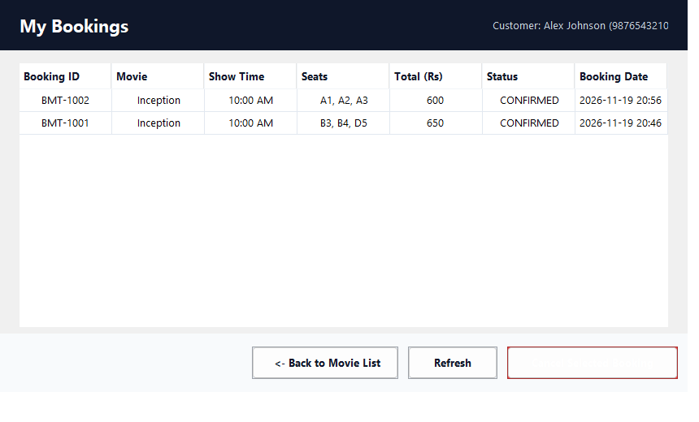
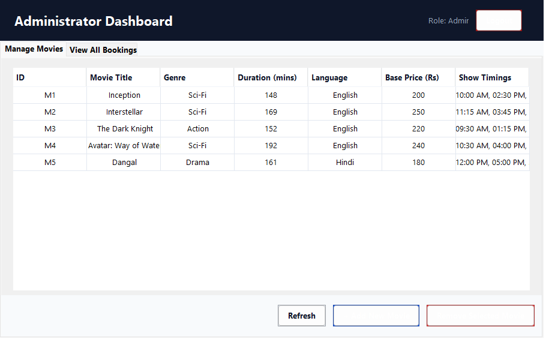
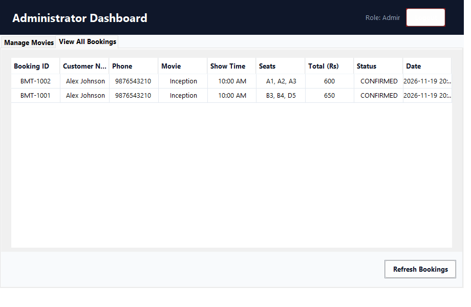
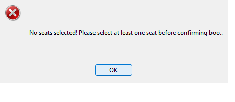

# Book My Ticket – Movie Ticket Booking System

A lightweight, robust, and clean desktop Movie Ticket Booking System built in pure Java (JDK 17+) using Java Swing (JFrame). Designed for the college course **22IT321 Object Oriented Programming**, this project exemplifies key OOP paradigms without any external databases, web frameworks, or third-party dependencies.

---

## 1. Project Overview

**Book My Ticket** provides a seamless desktop cinema reservation experience. The system caters to two primary user profiles:
- **Customer (Patron):** Logs in with their name and phone number to browse currently screening movies, select show timings, choose seats in real time from an interactive 5x8 visual seat grid, generate booking confirmation tickets, and review/cancel past reservations.
- **Administrator:** Logs in with a fixed administrative credential (`admin123`) to manage the movie catalog (adding/removing movies and screening schedules) and audit all customer bookings across the entire system.

### Technology Stack
- **Language:** Pure Java (JDK 17 or higher; tested on JDK 26)
- **GUI Framework:** Java Swing (`javax.swing.*`) and AWT (`java.awt.*`)
- **Persistence:** Local Flat-File CSV Storage (`data/movies.txt`, `data/bookings.txt`) via Java standard I/O (`BufferedReader`, `BufferedWriter`)
- **Build System:** Plain `javac`, `java`, and standard `jar` packaging (no Maven or Gradle required)

---

## 2. Features

- **Dual-Role Authentication:** Clean toggle on the login screen for Customer (Name + 10-digit Phone) or Administrator (fixed password `admin123`).
- **Interactive Movie Catalog:** Tabular display showing Movie Title, Genre, Duration, Language, Base Price, and available Show Timings.
- **Dynamic 5x8 Seat Matrix:**
  - 40 seats arranged across 5 rows (A through E) and 8 columns (1 through 8).
  - Two distinct seat tiers: **Regular** (Rows A, B, C) and **Premium** (Rows D, E) with differential pricing.
  - Live seat status color coding (Regular: Blue, Premium: Purple, Selected: Emerald Green, Booked/Unavailable: Disabled Slate Gray).
  - Screen guidance indicator ("ALL EYES THIS WAY: CINEMA SCREEN").
- **Real-Time Price Calculation:** Dynamic subtotal calculation as seats are clicked, using polymorphic price evaluation.
- **Thread-Safe Reservation Engine:** `synchronized` booking operations to eliminate race conditions and avoid double-booking.
- **Asynchronous Disk Storage:** File saves offloaded to background threads via `SwingWorker` to keep the UI silky smooth.
- **Booking Receipt / Ticket Slip:** Formatted modal ticket showing booking reference ID (`BMT-1001`), movie details, seat numbers, total price, and timestamp.
- **Customer Booking Management:** "My Bookings" portal allowing customers to view history and cancel reservations, immediately making released seats available again.
- **Admin Management Suite:**
  - Add new movies with custom metadata, base price, and multiple show times.
  - Remove existing movies from the active schedule.
  - System-wide booking audit table.
- **Fault-Tolerant Error Handling:** Custom checked exceptions (`InvalidInputException`, `SeatAlreadyBookedException`) rendered via informative `JOptionPane` alerts.

---

## 3. Architecture

The system adheres to a classic layered architectural design:
```
[ Presentation Layer (UI Frames & Dialogs) ]
                     │
                     ▼
[ Business Logic & Coordination (Service Layer) ]
                     │
                     ▼
[ Domain Entities & Contracts (Model Layer) ]
                     │
                     ▼
[ Persistence & I/O (FileManager / Flat Files) ]
```

### Architecture Diagram


### Package Responsibilities

| Package | Responsibility |
|---|---|
| `com.bookmyticket` | Contains `Main.java`, the entry point that initializes storage, services, shutdown hooks, and launches the UI on the Event Dispatch Thread (EDT). |
| `com.bookmyticket.model` | Encapsulates domain entities (`Person`, `Customer`, `Admin`, `Movie`, `Show`, `Seat`, `RegularSeat`, `PremiumSeat`, `Booking`) and contracts (`Bookable`). |
| `com.bookmyticket.service` | Encapsulates core business rules, thread synchronization, calculations, and coordination (`MovieService`, `BookingService`). |
| `com.bookmyticket.util` | Handles persistent flat file reads and writes using standard Java I/O (`FileManager`). |
| `com.bookmyticket.exception` | Contains custom checked domain exceptions (`SeatAlreadyBookedException`, `InvalidInputException`). |
| `com.bookmyticket.ui` | Implements Swing graphical user interfaces, layout containers, custom styles, and event listeners (`LoginFrame`, `MovieListFrame`, `SeatSelectionFrame`, `MyBookingsFrame`, `AdminFrame`, `UIUtils`). |

---

## 4. Implementation Details

### Step-by-Step Booking Flow
1. **Login:** User opens the application and selects **Customer**, entering their Name and 10-digit Phone Number. On submit, input is validated and `MovieListFrame` opens.
2. **Browse Movies & Select Show:** The customer views all available films. Selecting a movie updates the available show times in a dropdown list. Clicking "Select Seats ->" navigates to the seat matrix.
3. **Seat Selection:** The 5x8 grid displays all 40 seats. The customer clicks available seats (Regular in blue, Premium in purple). Selected seats toggle to green, and the live total updates immediately.
4. **Booking Confirmation:** Clicking "Confirm Booking" opens a summary prompt. Upon confirmation, the synchronized `bookSeats(...)` method executes, reserves the seats, generates a unique Booking ID (`BMT-1001`), and writes to `data/bookings.txt` asynchronously via `SwingWorker`.
5. **Ticket Dialog:** A modal receipt window appears displaying complete reservation details.
6. **My Bookings & Cancellation:** The customer can open "My Bookings" at any time. Selecting a reservation and clicking "Cancel Selected Booking" marks the booking as cancelled and immediately releases the seats back to the show.

### How Seat Pricing Works
Seat pricing utilizes object-oriented polymorphism:
- `Seat` is an abstract base class with an abstract method `public abstract double getPrice()`.
- `RegularSeat` (Rows A, B, C) overrides `getPrice()` to return the movie's base ticket price:
  $$\text{Price}_{\text{Regular}} = \text{basePrice}$$
- `PremiumSeat` (Rows D, E) overrides `getPrice()` to include a luxury surcharge:
  $$\text{Price}_{\text{Premium}} = \text{basePrice} + 50.0$$
- `BookingService.calculateTotal(List<Seat> seats)` polymorphically iterates over chosen seats, invoking `seat.getPrice()` without checking explicit concrete classes.

### How Data Is Saved and Loaded
Data is persistently stored in human-readable CSV files inside the `data/` directory:
- **`data/movies.txt` format:**
  `movieId,title,genre,durationMinutes,language,basePrice,timings(separated by ;)`
  *Example line:*
  ```csv
  M1,Inception,Sci-Fi,148,English,200.0,10:00 AM;02:30 PM;06:45 PM
  ```
- **`data/bookings.txt` format:**
  `bookingId,customerName,customerPhone,movieId,movieTitle,showTime,seats(separated by ;),totalAmount,status,bookingDate`
  *Example line:*
  ```csv
  BMT-1001,Alex Johnson,9876543210,M1,Inception,10:00 AM,A3;A4;D4,650.0,CONFIRMED,2026-11-19 20:56
  ```
At application startup, `FileManager.initializeFiles()` automatically generates missing files and seeds 5 initial movies. On every state change and on window close, state is flushed to disk.

### Threading & Concurrency
- **Non-blocking UI Persistence:** When a booking is confirmed or cancelled, `BookingService.saveBookingsAsync()` dispatches file I/O to a background thread using `SwingWorker<Void, Void>`. This guarantees that disk latency never halts the Swing Event Dispatch Thread (EDT).
- **Thread-Safe Synchronization:** The booking method is declared `public synchronized Booking bookSeats(...)`. This ensures atomicity: if two background tasks or concurrent users attempt to book the same seat at the same instant, the synchronized monitor guarantees only one succeeds while the second receives a `SeatAlreadyBookedException`.

### Error Handling
Custom checked exceptions ensure clear separation of error detection and UI reporting:
- `InvalidInputException`: Thrown when fields are empty, phone numbers are not 10 digits, or negative durations/prices are input.
- `SeatAlreadyBookedException`: Thrown if a seat requested for reservation is already occupied.
All exceptions are caught gracefully in the UI layer and presented using native `JOptionPane` warning/error dialogs.

---

## 5. OOP Concepts Applied

| OOP Concept | File Location | Key Class / Method | Implementation Purpose |
|---|---|---|---|
| **Encapsulation** | `model/*.java` | All entity models | All fields are `private`; access is controlled via public getters/setters. |
| **Abstraction** | `model/Person.java`, `model/Seat.java`, `model/Bookable.java` | `Person`, `Seat`, `Bookable` | Abstract classes define entity contracts (`getRole()`, `getPrice()`); `Bookable` interface enforces `book()` and `cancel()`. |
| **Inheritance** | `model/Customer.java`, `model/Admin.java`, `model/RegularSeat.java`, `model/PremiumSeat.java` | Extends `Person`, Extends `Seat` | `Customer`/`Admin` inherit from `Person`; `RegularSeat`/`PremiumSeat` inherit from `Seat`. |
| **Polymorphism (Overriding)** | `model/RegularSeat.java`, `model/PremiumSeat.java` | `@Override public double getPrice()` | Different seat types calculate their price differently at runtime. `Person.getRole()` is also overridden. |
| **Polymorphism (Overloading)** | `service/BookingService.java` | `calculateTotal(...)` | Overloaded with 3 versions (standard seat list, discounted seat list, fixed unit count). |
| **Exception Handling** | `exception/*.java`, `util/FileManager.java`, `ui/*.java` | `SeatAlreadyBookedException`, `InvalidInputException` | Checked custom exceptions with `try-catch-finally` blocks around I/O and user input validation. |
| **Threading** | `service/BookingService.java` | `saveBookingsAsync()` via `SwingWorker` | Background worker thread saves bookings to disk without freezing the Swing GUI. |
| **Synchronization** | `service/BookingService.java` | `public synchronized Booking bookSeats(...)` | Synchronized critical section prevents concurrent double-booking of seats. |
| **File Handling** | `util/FileManager.java` | `loadMovies`, `saveMovies`, `loadBookings`, `saveBookings` | Read/write flat text files (`data/movies.txt`, `data/bookings.txt`) using `BufferedReader` and `BufferedWriter`. |
| **Collections** | `service/*.java`, `model/*.java` | `ArrayList<Movie>`, `HashMap<String, Booking>`, `List<Seat>` | `ArrayList` for ordered entity lists; `HashMap` for fast $O(1)$ booking lookups by ID. |
| **Event Handling** | `ui/*.java` | `ActionListener`, `ListSelectionListener`, `WindowListener` | Reacts to button clicks, seat matrix toggles, movie row selections, and window close events. |

---

## 6. How to Run

### Prerequisites
- Java Development Kit: **JDK 17 or higher** (Tested on JDK 17, 21, and 26).
- Standard operating system: Windows, Linux, or macOS.

### Admin Credentials
- **Username:** Admin (selected via radio button)
- **Password:** `admin123`

---

### Execution Option 1: Automated Scripts

#### On Windows (PowerShell or Command Prompt):
```powershell
.\run.bat
```

#### On Linux / macOS (Bash):
```bash
chmod +x run.sh
./run.sh
```

---

### Execution Option 2: Plain `javac` and `java` (Manual)

#### Windows PowerShell:
```powershell
# 1. Create output directory
if (!(Test-Path out)) { New-Item -ItemType Directory -Path out }

# 2. Compile all source files
javac -d out (Get-ChildItem -Recurse -Filter *.java src | ForEach-Object { $_.FullName })

# 3. Launch application
java -cp out com.bookmyticket.Main
```

#### Linux / macOS (Bash):
```bash
# 1. Create output directory
mkdir -p out

# 2. Compile all source files
javac -d out src/com/bookmyticket/exception/*.java \
             src/com/bookmyticket/model/*.java \
             src/com/bookmyticket/util/*.java \
             src/com/bookmyticket/service/*.java \
             src/com/bookmyticket/ui/*.java \
             src/com/bookmyticket/Main.java

# 3. Launch application
java -cp out com.bookmyticket.Main
```

---

### Execution Option 3: Runnable JAR

#### Windows PowerShell:
```powershell
# 1. Compile into out/
javac -d out (Get-ChildItem -Recurse -Filter *.java src | ForEach-Object { $_.FullName })

# 2. Package runnable JAR with manifest
jar cfm BookMyTicket.jar manifest.txt -C out .

# 3. Run the JAR
java -jar BookMyTicket.jar
```

#### Linux / macOS (Bash):
```bash
# 1. Compile into out/
javac -d out $(find src -name "*.java")

# 2. Package runnable JAR
jar cfm BookMyTicket.jar manifest.txt -C out .

# 3. Run the JAR
java -jar BookMyTicket.jar
```

---

## 7. Folder Structure

```
Book_my_ticket/
├── .gitignore                          # Git ignore specification (out/, *.class)
├── BookMyTicket.jar                    # Standalone executable JAR
├── manifest.txt                        # Manifest defining Main-Class: com.bookmyticket.Main
├── README.md                           # Comprehensive documentation
├── run.bat                             # Windows automated build & launch script
├── run.sh                              # Linux/macOS automated build & launch script
│
├── data/                               # Persistent flat file storage
│   ├── movies.txt                      # CSV file of movies, prices, and show timings
│   └── bookings.txt                    # CSV file of customer ticket bookings
│
├── src/                                # Java source code
│   └── com/
│       └── bookmyticket/
│           ├── Main.java               # App entry point, shutdown hooks, Swing launch
│           ├── exception/              # Custom checked exceptions
│           │   ├── InvalidInputException.java
│           │   └── SeatAlreadyBookedException.java
│           ├── model/                  # Domain model entities and contracts
│           │   ├── Admin.java          # Inherits Person
│           │   ├── Bookable.java       # Reservation contract interface
│           │   ├── Booking.java        # Implements Bookable
│           │   ├── Customer.java       # Inherits Person
│           │   ├── Movie.java          # Movie entity
│           │   ├── Person.java         # Abstract base class
│           │   ├── PremiumSeat.java    # Inherits Seat (with surcharge)
│           │   ├── RegularSeat.java    # Inherits Seat
│           │   ├── Seat.java           # Abstract class implementing Bookable
│           │   └── Show.java           # 40-seat screening schedule
│           ├── service/                # Business logic services
│           │   ├── BookingService.java # Synchronized bookings, SwingWorker save, totals
│           │   └── MovieService.java   # Movie listings and catalog management
│           ├── ui/                     # Java Swing graphical interfaces
│           │   ├── AdminFrame.java     # Admin management & audit dashboard
│           │   ├── LoginFrame.java     # Customer & Admin login
│           │   ├── MovieListFrame.java # Movie catalog table & show selection
│           │   ├── MyBookingsFrame.java# Personal bookings & cancellation
│           │   ├── SeatSelectionFrame.java # 5x8 interactive seat grid & ticket dialog
│           │   └── UIUtils.java        # Central styling, palette, buttons & tables
│           └── util/                   # Persistence utilities
│               └── FileManager.java    # CSV file read/write with try-catch-finally
│
├── tools/                              # Development and testing utilities
│   └── CaptureScreens.java             # Automated screenshot generator for Swing UI
│
├── docs/                               # System documentation and diagrams
│   ├── class_diagram.md                # Mermaid class diagram specification
│   ├── class_diagram.mmd               # Standalone Mermaid diagram source
│   ├── oop_concepts.md                 # Detailed OOP mapping table
│   ├── package_diagram.md              # Mermaid package diagram specification
│   ├── package_diagram.mmd             # Standalone Mermaid package diagram source
│   ├── requirements.md                 # Software Engineering requirements & use cases
│   ├── sample_output.md                # Real test run walk-through with captions
│   └── screenshots/                    # High-fidelity rendered application screenshots
│       ├── 01_login_customer.png
│       ├── 02_login_admin.png
│       ├── 03_movie_list.png
│       ├── 04_seat_selection.png
│       ├── 05_booking_ticket.png
│       ├── 06_my_bookings.png
│       ├── 07_admin_movies.png
│       ├── 08_admin_bookings.png
│       ├── 09_error_dialog.png
│       ├── class_diagram.png           # Rendered class diagram
│       └── package_diagram.png         # Rendered package diagram
│
└── report/                             # Academic course report (.docx)
    └── BookMyTicket_Report.docx        # Generated project report for 22IT321
```

---

## 8. Application Screenshots

### 1. Customer Login Screen


### 2. Administrator Login Screen


### 3. Movie Catalog & Show Selection


### 4. Interactive 5x8 Seat Selection Grid


### 5. Booking Confirmation Ticket Slip


### 6. Customer "My Bookings" & Cancellation


### 7. Administrator Panel – Manage Movies


### 8. Administrator Panel – System-Wide Booking Audit


### 9. Validation & Error Handling


---
*Created for 22IT321 Object Oriented Programming | Thiagarajar College of Engineering*
