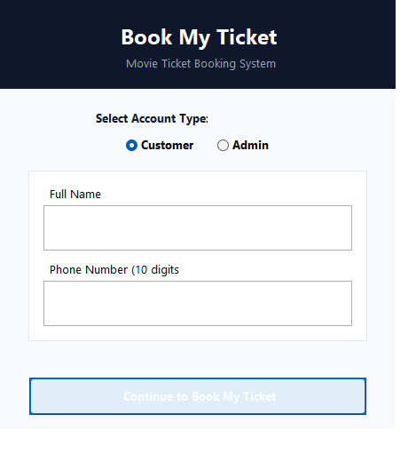
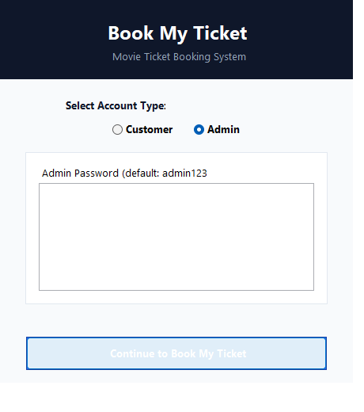
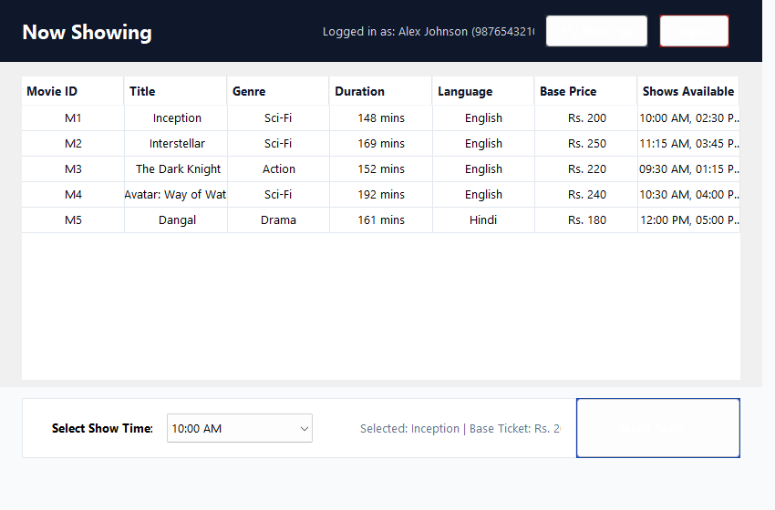
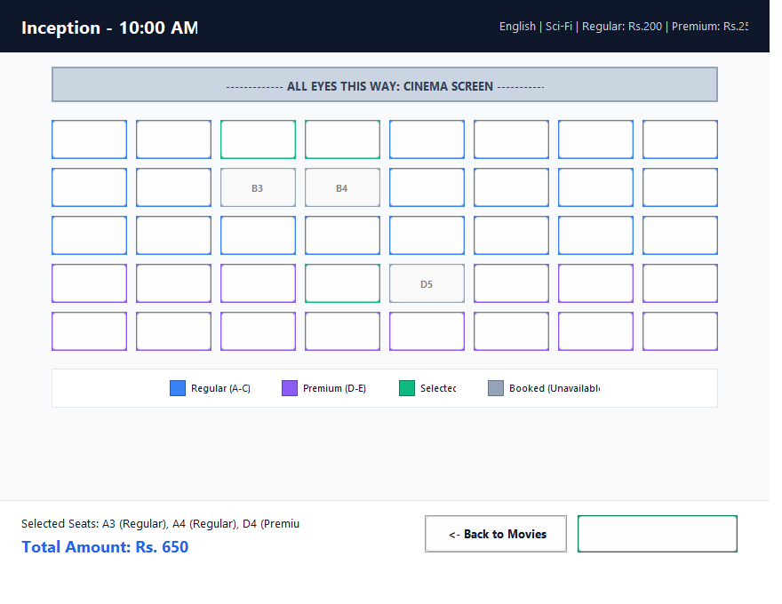
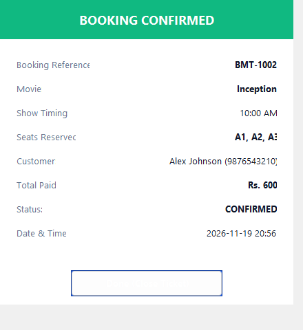
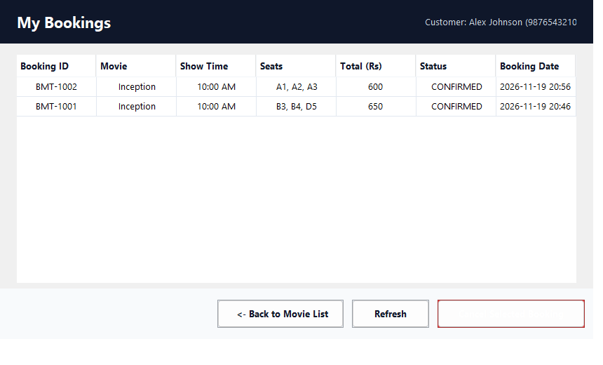
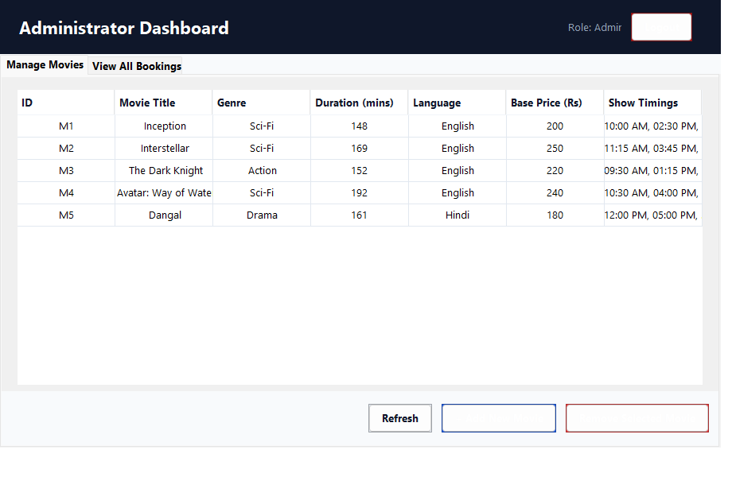
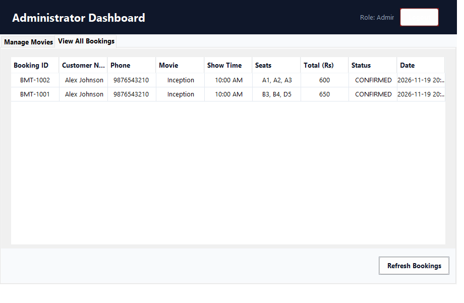
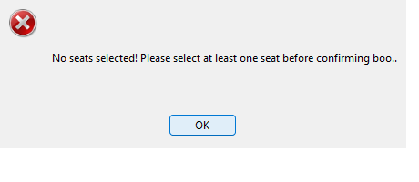

# Sample Output & Test Run: Book My Ticket

This document showcases the user interface and functional workflows of **Book My Ticket** during a real test run. All screenshots were generated directly from the live application.

---

### 1. Customer Login Screen

*Figure 1: Customer login screen prompting for Full Name and 10-digit Phone Number.*

---

### 2. Administrator Login Screen

*Figure 2: Administrator login portal requiring the secure fixed password (`admin123`).*

---

### 3. Movie Catalog & Show Selection

*Figure 3: Movie list displaying titles, genres, durations, languages, base ticket prices, and available show timings.*

---

### 4. Interactive Seat Matrix & Price Calculation

*Figure 4: 5x8 seat selection matrix displaying cinema screen guide, Regular (A-C) vs. Premium (D-E) seats, active selections in green, and real-time total price calculation.*

---

### 5. Booking Confirmation & Ticket Dialog

*Figure 5: Generated ticket slip showing unique Booking ID (`BMT-1001`), reserved seats, customer details, and total amount paid.*

---

### 6. Customer "My Bookings" & Cancellation

*Figure 6: Customer personal booking history showing confirmed reservations with one-click cancellation to release seats.*

---

### 7. Administrator Panel – Movie Management

*Figure 7: Administrator dashboard for adding new movies with multiple show schedules or removing existing movies.*

---

### 8. Administrator Panel – System-Wide Booking Audit

*Figure 8: Consolidated audit table showing all customer reservations across all movies and shows.*

---

### 9. Validation & Error Handling

*Figure 9: Graphical error alert triggered when a user attempts to confirm a booking without selecting any seats.*
